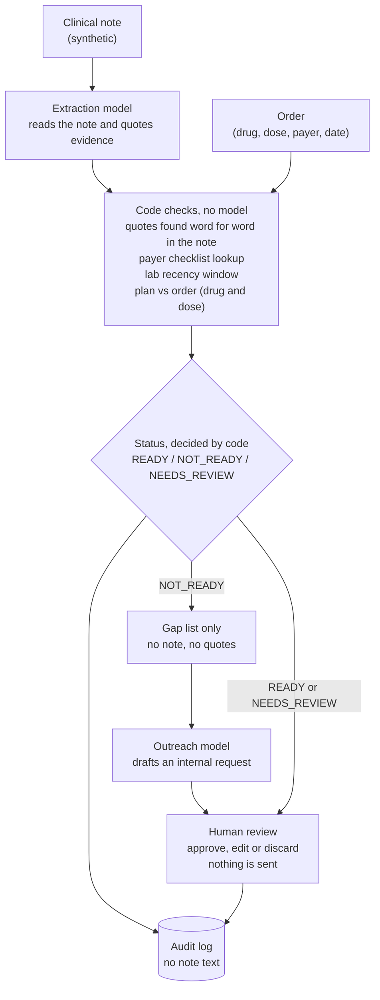

# PriorAuth Preflight

A prototype that checks a **synthetic** prior authorization packet before it is submitted. It
reads the clinical note, flags required items that are missing, stale or contradictory, quotes
the evidence for each, and drafts an internal request to the ordering provider's care team for
what is missing. A person reviews everything. **Nothing is ever sent, submitted or emailed.**

## How it works

1. A model reads the note and quotes the evidence for each item the payer requires.
2. Plain code checks every quote word for word against the note, compares it with the payer's
   rules and lab recency window, and decides the status: `READY`, `NOT_READY` or `NEEDS_REVIEW`.
3. If items are missing, a second model drafts an internal request from the gap list only (it
   never sees the note). A person approves, edits or discards it; only that decision is logged.

The model reads and drafts; code decides and verifies. See [SPEC.md](SPEC.md) for the design.

## Architecture



The model reads and drafts; code decides and verifies. The Outreach model sees only the gap list.

## Quick start

Requires Python 3.12 and [uv](https://docs.astral.sh/uv/).

```bash
git clone https://github.com/sandeepsingh2406/PriorAuth-Preflight.git
cd PriorAuth-Preflight
uv sync
cp env.example .env        # then open .env and set OPENAI_API_KEY, MODEL_DEV and MODEL_DEMO
uv run pytest -q           # the tests never call a model
uv run python -m src.run --case hand_04    # check one case from the command line
uv run python -m src.app                   # the one-screen UI at http://127.0.0.1:7860
uv run python eval/run_eval.py             # evaluate all 40 labeled cases
uv run python scripts/gen_cases.py         # regenerate the seeded synthetic cases
```

`.env` is git-ignored and keys are read from environment variables only. Model names come from
`MODEL_DEV` and `MODEL_DEMO` (set `USE_DEMO_MODEL=true` to use the second). The app listens on
this computer only. For a temporary public link, run it with `DEMO_MODE=1 uv run python -m src.app --share` and stop it when you are done.

## Results

Measured on 40 synthetic cases (10 hand-written, 30 generated; 7 ambiguous), 3 runs, one model.
Each cell is the value across the 3 runs; a range means the runs differed.

| Measure | Target | Hand-labeled (10 cases) | Generated (30 cases) |
| --- | --- | --- | --- |
| Status accuracy | - | 1.00 | 0.97 |
| Gap recall | >= 0.90 | 1.00 | 1.00 |
| False alarm rate | <= 0.10 | 0.00 | 0.00 |
| Escalation correctness | >= 0.80 | 1.00 | 0.80 |
| Citation validity (quotes in reports) | 1.00 | 1.00 | 1.00 |

Automatic sends: 0. No tool exists that submits, emails or sends anything.

**The one miss.** `gen_003` is an ambiguous case (a repeat lab on a later date with a different
value) that was scored `READY` instead of `NEEDS_REVIEW` in all 3 runs. That is the unsafe
direction: a packet that should have gone to a person was not flagged. It is not fixed. Re-running
it showed the model escalates it only about 2 of 5 times, so the steady result across 3 runs is
partly luck, and the escalation target is met only just. Whether it is truly ambiguous is a
labeling question; the label was left unchanged on purpose.

**Small and synthetic.** 40 invented notes, 3 runs, one model. These numbers describe this
prototype on this data, not real clinical practice. The full report, including the baseline run
and what changed after it, is in [eval/results.md](eval/results.md).

## What is in the repo

| Path | What it holds |
| --- | --- |
| `src/` | models, the code-only tools, the agents and prompts, the CLI runner and the UI |
| `data/` | three invented payer checklists, 30 generated cases, 10 hand-written cases, labels |
| `eval/` | the evaluation harness and its report, [eval/results.md](eval/results.md) |
| `tests/` | the test suite |
| `scripts/` | the seeded case generator and the gate script |

## Safety

- No tool exists that submits, emails or sends anything, and a test scans `src/` to keep it that way.
- Every quoted piece of evidence must be an exact substring of the note, or it counts as not found.
- The drafting model receives only the list of gaps, never the clinical note or quotes from it.
- Every run, and the person's decision, is appended to an audit log that never holds note text.

## Limits

- **Synthetic data only.** Every patient, date and identifier is fictional. Do not put real
  patient data in this repository or in the app.
- **Illustrative checklists.** The three payers are invented and are not real payer policy.
- **Documentation completeness only.** It does not judge whether a treatment is appropriate.
- **The model can miss or misread.** The quotes are shown so that a person can check them.
- **Input limits.** A note is limited to 2,000 characters and the order fields to a few dozen; pasted text over a limit is refused with a message and nothing is sent to a model.
- **Small evaluation.** 40 cases, 7 of them ambiguous, one model; the report lists its failures.

## License

MIT, see [LICENSE](LICENSE).
